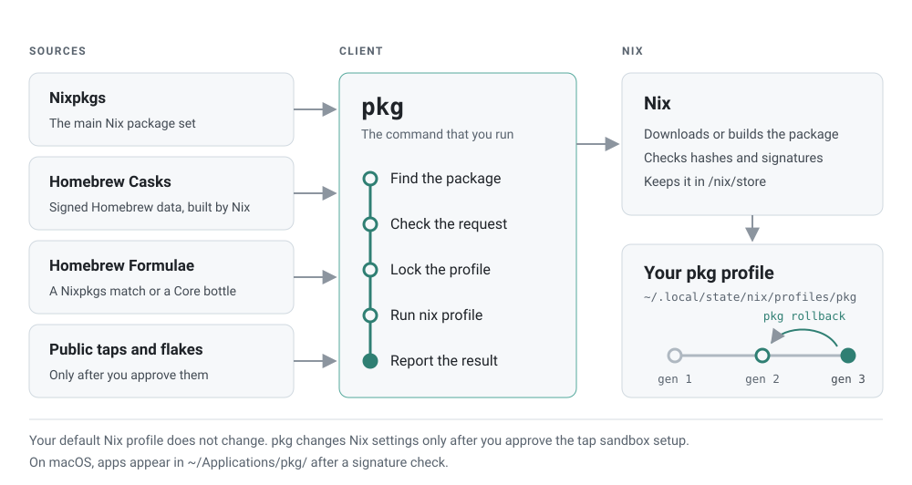
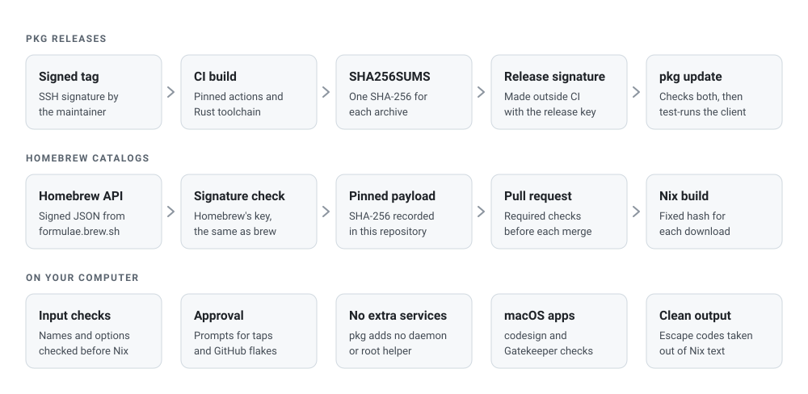

<p align="center">
  <picture>
    <source media="(prefers-color-scheme: dark)" srcset="docs/assets/banner-dark.svg">
    
  </picture>
</p>

<p align="center"><strong>Familiar package commands on top of Nix.</strong></p>

<p align="center">
  <a href="https://github.com/spa5k/pkg/releases/latest"></a>
  <a href="https://github.com/spa5k/pkg/actions/workflows/ci-fast.yml"></a>
  <a href="LICENSE"></a>
</p>

<div align="center">

[Install](#install) · [Usage](#usage) · [How it works](#how-pkg-uses-nix) · [Security](#security) · [Docs](docs/index.md)

</div>

`pkg` searches, installs, upgrades, and rolls back packages from Nixpkgs,
Homebrew Casks, Homebrew Formulae, and GitHub flakes. It uses
[Nix](https://nixos.org) underneath. You do not need to know Nix to use it.

> [!WARNING]
> `pkg` is alpha software. Commands, files, and output can change before
> v1. Old alpha installations are not migrated.

## Why pkg

- **One command for many sources.** Nixpkgs, Homebrew Casks, Homebrew
  Formulae, public Cask taps, and GitHub flakes use the same commands.
- **You can undo every change.** Each change makes a new Nix profile
  generation. `pkg rollback` goes back to the previous one.
- **No Homebrew installation.** Casks and Formulae install as ordinary Nix
  packages. `pkg` never runs `brew`.
- **Fast local search.** Search reads catalogs on your disk. It makes no
  network request.
- **Small footprint.** One binary in `~/.local/bin`. No daemon, no root
  helper, and no telemetry.
- **Signed releases.** `pkg update` installs a new client only when its
  release has a valid signature.

## Install

```sh
curl -fsSL https://github.com/spa5k/pkg/releases/latest/download/install.sh | sh
```

Then open a new terminal window.

Requirements:

- x86_64 Linux with glibc 2.35 or newer, or macOS on Apple silicon.
- Nix. When Nix is missing, the installer asks once whether to install
  [Determinate Nix](https://docs.determinate.systems/determinate-nix/).

The installer puts `pkg` in `~/.local/bin`, verifies the archive checksum,
and sets up Bash, Zsh, or Fish. It turns on a daily user job that updates
`pkg` and its search data. It never runs `sudo` itself. Run the same command
again to repair the setup. Run `pkg self uninstall` to remove `pkg`. Nix and
your packages stay.

Details are in the [install guide](docs/install.md).

## Usage

```sh
pkg search ripgrep         # Find packages
pkg info rg                # Show details, commands, and other sources
pkg install ripgrep        # Install a package
pkg install rg             # Command names work too
pkg list                   # List installed packages and versions
pkg upgrade                # Upgrade all packages
pkg remove ripgrep         # Remove a package
pkg history                # Show past changes
pkg rollback               # Undo the last change
pkg update                 # Update pkg and its search data
pkg doctor                 # Check the setup
```

`pkg add` is the same as `pkg install`. `pkg uninstall` is the same as
`pkg remove`. The [command guide](docs/commands.md) has every command and
option.

### Package sources

| Source | ID | Example |
| --- | --- | --- |
| Nixpkgs | `nixpkgs:<attribute>` | `pkg install nixpkgs:ripgrep` |
| Homebrew Casks | `cask:<token>` | `pkg install cask:firefox` |
| Homebrew Formulae | `brew:<name>` | `pkg install brew:awscli` |
| Public Cask taps | `cask:<owner>/<tap>/<token>` | `pkg tap add goreleaser/tap` |
| GitHub flakes | `github:<owner>/<repo>#<attribute>` | `pkg install github:owner/repo#tool` |

A bare name such as `ripgrep` checks the sources in this order: Nixpkgs,
Homebrew Casks, Homebrew Formulae, then saved taps. The first match wins.
`pkg info` and `pkg install` name the other sources that have the same name.
A command name also works: `pkg install rg` installs `ripgrep`.

On macOS, app bundles appear as launchers in `~/Applications/pkg/`.

## How pkg uses Nix

<picture>
  <source media="(prefers-color-scheme: dark)" srcset="docs/assets/how-it-works-dark.svg">
  
</picture>

Nix does the package work. `pkg` gives it a simple interface.

- **One profile for your packages.** `pkg` keeps your packages in its own
  Nix profile, `~/.local/state/nix/profiles/pkg`. Your default Nix profile
  does not change.
- **Nix owns the state.** `pkg` reads installed packages, versions, and
  generations from Nix. It never reads them from a cache.
- **Every source is a Nix flake.** Nixpkgs comes from
  `github:NixOS/nixpkgs/nixpkgs-unstable`. Casks and Formulae come from the
  flakes in [`nix/`](nix), which this repository generates from signed
  Homebrew data. An upgrade follows the reference that you installed from.
- **Packages stay separate.** Nix keeps each package in its own path in
  `/nix/store`. One package cannot overwrite the files of another.
- **Changes are generations.** Each install, remove, or upgrade adds one
  generation. `pkg history` shows them. `pkg rollback` goes back.
- **Search is local.** The daily job downloads the package list that the
  NixOS channel publishes. Search reads that list on your disk.

`pkg` does not install, update, repair, or remove Nix.

## Security

<picture>
  <source media="(prefers-color-scheme: dark)" srcset="docs/assets/security-dark.svg">
  
</picture>

### What pkg checks

| What | Check |
| --- | --- |
| `pkg` updates | `pkg update` checks the Ed25519 signature of `SHA256SUMS` with the release key in the client. Then it checks the SHA-256 of the archive. It starts the new client once before it replaces the old one. |
| First install | `install.sh` downloads over HTTPS with TLS 1.2 or newer, and it checks the SHA-256 of the archive. |
| Homebrew data | The catalog job accepts Homebrew API data only with a valid signature by Homebrew's `homebrew-1` key. `brew` does the same check. The repository pins each payload by SHA-256. |
| Cask and Formula downloads | Each download has a fixed SHA-256 in its Nix package. Nix refuses other bytes. |
| Nixpkgs packages | Nix checks the binary cache signatures with the keys that your Nix trusts. |
| macOS apps | Before `pkg` makes a launcher for a Cask app, it runs `codesign --verify --deep --strict` and `spctl --assess`. A rejected app gets no launcher. |
| GitHub flakes | `pkg install` asks for approval before Nix evaluates a `github:` flake. `pkg info` evaluates the flake without a prompt, but it does not build or run it. |
| Public taps | `pkg tap add` asks for approval before it fetches a tap. Tap Ruby runs only inside a Nix build sandbox. |

### Least privilege

- `pkg` adds no daemon, broker, or root helper. The daily job is a user job
  that exits after each run.
- `pkg` passes `accept-flake-config = false` and
  `allow-import-from-derivation = false` to every Nix command. A flake
  cannot change Nix settings, substituters, or keys.
- Two optional setup steps ask for administrator access, and only after you
  approve: `pkg apps setup` on macOS, and the sandbox setup for public taps.
  They call `/usr/bin/sudo` and other programs by absolute path.

### Input and output

- `pkg` checks each argument, package ID, and configuration value before it
  passes it to Nix. It refuses control characters, values that start with
  `-`, and plain `http` sources.
- `pkg` removes terminal control sequences from text that Nix, a flake, or
  a catalog supplies. Colors and line breaks stay.
- Downloads by `pkg` use HTTPS only and have size limits. Output from a
  child process stops at 256 MiB.

### Repository and releases

- Every commit on `main` must be signed. It must pass the build, test,
  format, clippy, docs, dependency, and link checks, and a client smoke
  test on Linux and on macOS.
- Release tags carry the maintainer's SSH signature. The release key signs
  `SHA256SUMS` outside CI.
- GitHub Actions are pinned to commit SHAs. Workflow tokens are read-only
  by default. The Rust toolchain is pinned.
- `cargo deny` checks licenses, banned crates, and crate sources on every
  pull request.

### Verify a release yourself

`install.sh` does not check the release signature. A first install trusts
GitHub and TLS. To check a release by hand:

```sh
base=https://github.com/spa5k/pkg/releases/latest/download
curl -fsSLO "$base/SHA256SUMS"
curl -fsSLO "$base/SHA256SUMS.sig"
curl -fsSLO "$base/pkg-<version>-aarch64-darwin.tar.gz"   # or x86_64-linux
echo 'pkg-release ssh-ed25519 AAAAC3NzaC1lZDI1NTE5AAAAIOaFZma99iXoZWruu1raDx1IAPNLJPOF/TYfXbAvyehh' > allowed_signers
ssh-keygen -Y verify -f allowed_signers -I pkg-release -n pkg-release -s SHA256SUMS.sig < SHA256SUMS
shasum -a 256 --ignore-missing -c SHA256SUMS
# On Linux: sha256sum --ignore-missing -c SHA256SUMS
```

The key must be in `RELEASE_KEYS` in
[`crates/pkg-cli/src/client.rs`](crates/pkg-cli/src/client.rs).

### Limits

- A checksum proves the bytes. It does not prove that the publisher is
  trustworthy.
- On macOS, the Nix build sandbox is off by default. A GitHub flake runs its
  build code on your computer. Approve only flakes that you trust.
- The macOS check proves a valid Developer ID signature and Apple's current
  assessment. It does not scan for malware, and it does not isolate the app
  when it runs. Command-line tools and Nixpkgs apps are outside this check.
- Tap approval allows tap Ruby to run during the import. It does not
  certify the app.
- `pkg` trusts Nix, the binary caches that your Nix trusts, and GitHub.

### Report a vulnerability

Do not open a public issue. Read [SECURITY.md](SECURITY.md).

## Privacy

`pkg` has no telemetry. It sends no data about your packages. It connects
to GitHub for releases and flakes, and to the NixOS channel for the search
list. Nix downloads packages from its binary caches and from vendor URLs.
See [privacy](docs/privacy.md).

## Platform support

| Platform | Status |
| --- | --- |
| Linux x86-64 | Alpha. Needs glibc 2.35 or newer. The daily job needs a systemd user session. |
| macOS Apple silicon | Alpha. Tested on macOS 15.7.7. |
| macOS Intel | Not supported. |
| Linux arm64 | Not supported. |

The tested Nix runtimes are Determinate 3.22.1 and 3.22.5 with Nix 2.35.2.
On Linux, Cask AppImages and binaries were tested without a desktop. A Cask
in the catalog is eligible by its metadata. This is not a promise that it
works. See [casks](docs/casks.md) and [support](docs/support.md).

## Documentation

- [Install](docs/install.md): setup, files, the daily job, and removal.
- [Commands](docs/commands.md): every command, package IDs, and output.
- [Casks](docs/casks.md): the Cask catalog, public taps, and trust limits.
- [Support](docs/support.md): troubleshooting and supported runtimes.
- [Privacy](docs/privacy.md): what `pkg` sends and stores.
- [Architecture](docs/architecture.md): the module map and code owners.

## Contributing

Read [CONTRIBUTING.md](CONTRIBUTING.md) for the toolchain, the checks, and
the OpenSpec workflow. The design baseline is
[Simplify pkg to native Nix](openspec/changes/archive/2026-10-12-simplify-to-native-nix/proposal.md).
The [OpenSpec archive](openspec/changes/archive/README.md) records earlier
changes.

## License

`pkg` is licensed under the [Apache License 2.0](LICENSE). Homebrew metadata
is available under the
[BSD-2-Clause license](tools/formula-catalog/inputs/LICENSE.txt). Each
package keeps the license of its upstream project.

`pkg` is not affiliated with Homebrew, the NixOS Foundation, or Determinate
Systems.
