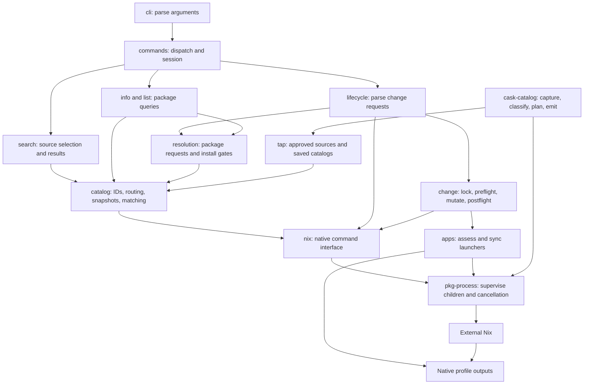

# Module map

The client uses one external Nix runtime and one native profile.
Nix owns installed state and generations.
Catalog data is disposable.

## Find the owner

Paths below start at the repository root.

| Responsibility | Owner |
| --- | --- |
| Argument grammar | `crates/pkg-cli/src/cli.rs` |
| Command dispatch and session | `crates/pkg-cli/src/commands/mod.rs` |
| Typed command errors and signal exit codes | `crates/pkg-cli/src/commands/error.rs` |
| Search source groups and prefixes | `crates/pkg-cli/src/commands/search/source.rs` |
| Search collection | `crates/pkg-cli/src/commands/search/mod.rs` |
| Bounded result storage and output | `crates/pkg-cli/src/commands/search/results.rs` |
| Package information and installed entries | `crates/pkg-cli/src/commands/info.rs`, `list.rs` |
| Package Resolution and upgrade eligibility | `crates/pkg-cli/src/commands/resolution.rs` |
| Package change requests and history | `crates/pkg-cli/src/commands/lifecycle.rs` |
| Locked native package changes and app refresh ordering | `crates/pkg-cli/src/commands/change.rs` |
| Checked profile lock ownership | `crates/pkg-cli/src/profile_lock.rs` |
| Name resolution and disposable snapshots | `crates/pkg-cli/src/catalog/` |
| External Nix discovery | `crates/pkg-cli/src/nix/runtime.rs` |
| Native command interface | `crates/pkg-cli/src/nix/mod.rs` |
| Child supervision and cancellation | `crates/pkg-process/src/lib.rs` |
| Native profile and source decoding | `crates/pkg-cli/src/nix/manifest.rs` |
| Generated index types and validation | `crates/pkg-cli/src/nix/index/` |
| Generated index target and entry lookups | `crates/pkg-cli/src/nix/index/model.rs` |
| Tap approval and atomic publication | `crates/pkg-cli/src/tap/` |
| Tap commands and import validation | `crates/pkg-cli/src/commands/tap/` |
| App sync coordination | `crates/pkg-cli/src/apps/mod.rs` |
| Bundle discovery and private payload preparation | `crates/pkg-cli/src/apps/scan.rs`, `payload.rs` |
| Public tap app assessment | `crates/pkg-cli/src/apps/assessment.rs` |
| Launcher destination ownership | `crates/pkg-cli/src/apps/destination.rs` |
| Staged launcher publication and recovery | `crates/pkg-cli/src/apps/publication.rs` |
| App helper execution and cache storage | `crates/pkg-cli/src/apps/helper.rs`, `storage.rs` |
| Shared source and token identity rules | `tools/cask-catalog/src/token.rs` |
| Shared numeric version rules | `tools/cask-catalog/src/version.rs` |
| Cask classification and build plans | `tools/cask-catalog/src/classify/`, `plan/` |

## Follow a change

Search selects sources once, then reads local snapshots.
Its SQLite result store bounds memory use for large catalogs.
Package Resolution owns source selection, formula aliases, catalog reads, and availability.
Inspection reports recorded availability.
Installation checks the full batch before it changes the profile.
Qualified requests read only their selected source.
Bare requests check every source for ambiguity.
A package mutation takes the profile lock and calls Nix.
Upgrade preparation selects entries and validates the Tap Registry once.
It checks removed Tap Sources before it reports Fixed Reference skips.
It checks the full remaining batch before it changes the profile.
The held-profile value binds app refresh to the same profile and lock.
The command reads native state after a failure or cancellation.
On macOS, app sync assesses bundles and checks destination ownership.
It accepts only the current `pkg-cask-apps/2` private payload layout.
The helper writes launchers into a private staging directory.
Publication and recovery use exclusive renames to preserve existing destination entries.
Failed or canceled helper work keeps the previous launchers and source map.
Dock changes are reported separately.

Commands routed through `pkg-process` have one synchronous child owner.
The process crate and both libraries declare their Unix platform scope once.
The client and generator retain their active code and resource scopes.
Signal handlers record cancellation for that owner.
The owner observes exit without consuming the wait status.
Bounded metadata and tap import children have a dedicated process group.
The owner finishes group cleanup before it starts the consuming wait.
It disables further signaling before that wait can release the child identity.
Each pipe read pass has a fixed budget so continuous output cannot block cancellation checks.
Supplied stdin uses the same nonblocking supervision loop.
The supervisor borrows the remaining input instead of copying it.
Input failures retain child cancellation and the I/O cause after reaping.

Tap staging owns its source store and exclusive lock.
Publication consumes the stage and keeps that same store through cleanup and undo.
The staging guard drops before the lock on failure.
The caller cannot select a different store for publication.

The client and generator use the same identity and numeric version rules.
The generator owns classification and build plans.
Both use one Catalog Exclusion value with a typed reason and optional detail.
An eligible outcome carries a plan; a refused outcome carries that exclusion.
Artifact kind and target support use one rule table.
The client validates generated indexes and reports their recorded status.
Catalog IDs have checked constructors and one representation with a borrowed kind.
All catalog index decoding uses the strict cask or Formula decoder.
Saved catalog construction checks its provenance and derives its stable reference.
Saved collections derive their keys from those checked values.
Saved catalogs and query views share immutable indexes with `Rc`.
The validated Catalog Index owns target, entry, and token lookups.
Availability and package information read its recorded entry status directly.
Catalog caches use one atomic JSON writer.
Typo matching uses the locked `strsim` optimal string alignment algorithm.
The query retains its character and distance limits.
Tap cache writes require a mutable borrow.
Metadata rows use a tagged enum with a required payload for each kind.
Native, configuration, and cache errors keep their causes until command reporting.
Configured native-probe errors own their original Nix error in a typed box.
Native mutation callers pass their known profile to the reporter constructor.
The reporter requires that profile and does not recover it from command arguments.
Catalog routing owns the Sources record and its tap references.
Resolved install targets and their display names share one ordered map.
The map keeps the first target position and the last name for a duplicate.
All original requests receive resolution and availability checks before insertion.
Filtered process mode owns the required mutable reporter borrow.
Finishing retires that borrow before the final reporter callback.
Host path validation shares its ordered loops and retains each host's policy.
The bounded archive reader owns a memory gzip decoder.
Its final drain keeps 64 KiB reads to retain damage and byte-limit error order.

Historical experiment findings remain under `spikes/`.
Their source links point to the last revision before removal.
Current work follows [Simplify the native client](../openspec/changes/archive/2026-10-12-simplify-client/design.md).
Rust ownership and error rules follow
[Rust design](../openspec/changes/archive/2026-10-12-improve-rust-quality/design.md).
The complete quality change follows
[Complete the Rust quality plan](../openspec/changes/archive/2026-10-12-complete-rust-quality-plan/design.md).
The [completion report](verification/rust-quality-completion-2026-10-12.md) records the final behavior and verification limits.
