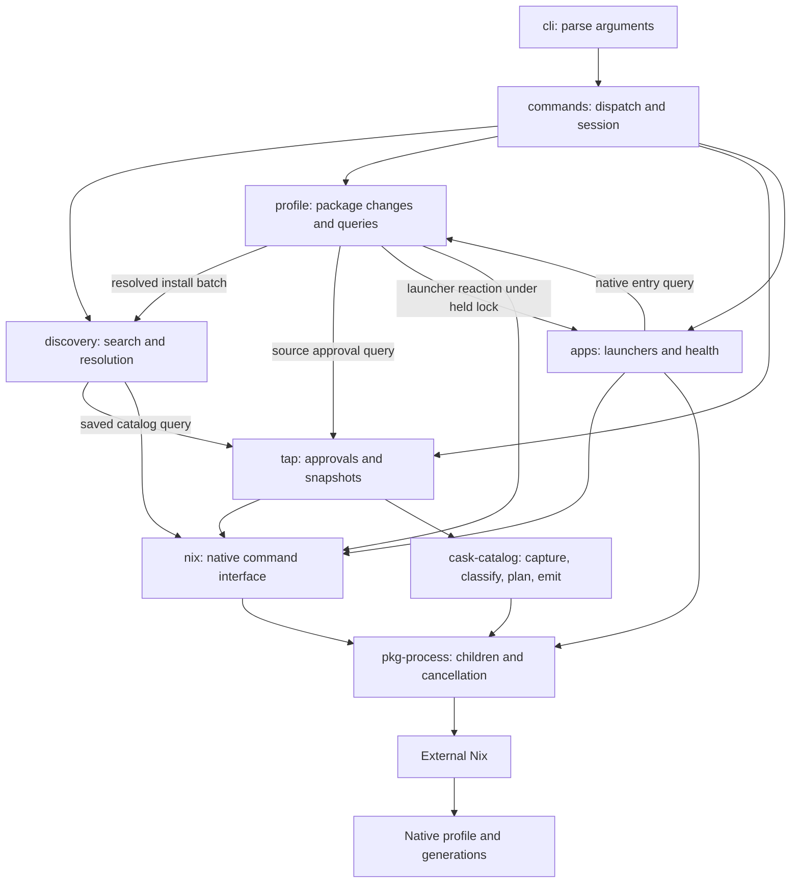

# pkg architecture

The client uses one external Nix runtime and one native profile.
Nix owns installed state and generations.
Catalog data is disposable.

## The nouns

These terms describe code ownership. Product terms are defined in
[pkg Language](../CONTEXT.md).

| Noun | Meaning in pkg |
| --- | --- |
| Feature | One pkg capability with one owner for its rules, commands, queries, and state access. Its directory name is its code identity. The client features are `profile`, `discovery`, `tap`, and `apps`. |
| Command | A typed request to change state, such as installing a Package, approving a Tap, or refreshing Discovery Data. The owning feature checks the whole request before it writes. |
| Query | A request to inspect packages, installed entries, generations, or health. It does not change the pkg Profile, Tap Approvals, or launchers. Discovery queries can fill disposable metadata caches. |
| Outcome | An observed result of a Command. It can report a completed change, no change, a partial change, or unknown state. A successful child exit alone does not prove the requested state. |
| Reaction | A follow-up action after an Outcome. For example, launcher refresh follows a completed profile operation. The caller runs it directly and reports its failure separately. |
| Repository | The module that owns access to one kind of stored state. Nix owns the pkg Profile. The Tap Registry and Tap Snapshot store have their own owners. A cache is never installed-state authority. |
| Operation | The ordered work needed to complete a Command: lock, check, apply, observe, and react. It runs in the current process. A later invocation reads current state before it attempts more work. |
| Entry point | A CLI invocation, scheduled refresh invocation, or catalog tool invocation. It parses input and sends a typed request to its owner. It does not define package rules. |
| Platform | Shared process supervision, configuration paths, locks, and output primitives. Feature rules stay with their owner. |

Outcomes, Reactions, and Operations describe local, synchronous work.
A Reaction runs under its Operation's ordering rules.
An Operation does not persist waits or retry native mutations automatically.

## Ownership rules

- Read installed state from Nix. Never infer it from a catalog, cache, or launcher.
- Keep package changes under one profile lock. Hold that lock through the final
  native read and launcher refresh.
- Keep queries separate from mutation code. `history` is a Query even though it
  prints native text. `--json` is an output option, not a command classification.
- Treat cache writes during discovery as derived work. They cannot approve a Tap,
  publish a Tap Snapshot, or change installed packages.
- Observe native state after a failed or interrupted mutation. Preserve the signal
  and report known changes before returning an exit code.
- Call another feature through its interface. Profile operations request launcher
  refresh from Apps; they do not write launcher files.
- Keep each store's lock and publication rules with its owner. The profile lock
  serializes pkg clients. It does not prevent external Nix commands from running.

## Feature interfaces

Each feature groups its command paths, query paths, and state rules.
The command dispatcher calls the feature interface.
Setup and update compose Discovery and Tap commands under one refresh lock.
Doctor reads feature queries and does not repair state.

| Feature | Interface | Owned work |
| --- | --- | --- |
| Profile | `profile/mod.rs` | Install, remove, upgrade, rollback, prune, list, history, and native profile health. |
| Discovery | `discovery/mod.rs` | Search, package information, resolved install batches, upgrade eligibility, and disposable catalog preparation. |
| Taps | `tap/mod.rs` | Approval, import validation, publication, removal, saved catalog reads, and tap health. |
| Apps | `apps/mod.rs` | Launcher commands, assessment, publication, health, and the reaction to a completed profile change. |
| Cask generation | `tools/cask-catalog/src/lib.rs` | Capture, classification, build plans, and generated catalog output in its separate crate. |

```text
src/
  commands/          argument dispatch, session, diagnostics, and combined setup/update
  profile/
    mod.rs           profile command and query interface
    change.rs        typed requests, lock, preflight, mutation, and observation
    query.rs         native entries, generation history, and profile health
    lock.rs          held profile lease
    installed.rs     installed identity and entry selection
    conflict.rs      file conflicts and verified package owners
  discovery/
    mod.rs           search, information, and resolution interface
    catalog/         IDs, routing, disposable snapshots, and matching
    resolution.rs    source selection, install batches, and upgrade eligibility
    search/          source selection, bounded result storage, and rendering
    info.rs          package information
    refresh.rs       disposable catalog preparation
  tap/
    mod.rs           tap command and query interface
    command/         approval, staging, validation, publication, and removal
    query.rs         registry snapshots, lazy catalog reads, and health
    registry.rs      approval records
    saved.rs         strict saved catalog loading
    store.rs         locked generation publication and recovery
  apps/
    mod.rs           launcher synchronization and health
    command.rs       explicit commands and the profile-change reaction
```

Profile operations request a resolved install batch from Discovery.
They check withdrawn source approval through Taps.
Apps reads native entries through the Profile query interface.
The Apps reaction takes the held profile lease, so launcher refresh cannot lose
its ordering with the package change.
Discovery reads each selected Tap Snapshot through Taps.
A qualified request isolates an unrelated broken source.
Bare-name resolution requires all approved sources to prevent hidden ambiguity.

The public `pkg_cli::catalog` import remains available as a re-export of
`discovery::catalog`.
The [verification record](verification/2026-10-18-feature-model.md) lists the
checks and platform limits.

## Module map



## Find the owner

Paths below start at the repository root.

| Responsibility | Owner |
| --- | --- |
| Argument grammar | `crates/pkg-cli/src/cli.rs` |
| Command dispatch and session | `crates/pkg-cli/src/commands/mod.rs` |
| Typed command errors and signal exit codes | `crates/pkg-cli/src/commands/error.rs` |
| Search source groups and prefixes | `crates/pkg-cli/src/discovery/search/source.rs` |
| Search collection | `crates/pkg-cli/src/discovery/search/mod.rs` |
| Bounded result storage and output | `crates/pkg-cli/src/discovery/search/results.rs` |
| Package information | `crates/pkg-cli/src/discovery/info.rs` |
| Installed entries and history | `crates/pkg-cli/src/profile/query.rs` |
| Package Resolution and upgrade eligibility | `crates/pkg-cli/src/discovery/resolution.rs` |
| Profile feature interface | `crates/pkg-cli/src/profile/mod.rs` |
| Locked native package changes and state observation | `crates/pkg-cli/src/profile/change.rs` |
| Profile file conflict reporting | `crates/pkg-cli/src/profile/conflict.rs` |
| Checked profile lock ownership | `crates/pkg-cli/src/profile/lock.rs` |
| Shared advisory lock primitive | `crates/pkg-cli/src/profile_lock.rs` |
| Name resolution and disposable snapshots | `crates/pkg-cli/src/discovery/catalog/` |
| External Nix discovery | `crates/pkg-cli/src/nix/runtime.rs` |
| Native command interface | `crates/pkg-cli/src/nix/mod.rs` |
| Child supervision and cancellation | `crates/pkg-process/src/lib.rs` |
| Native profile and source decoding | `crates/pkg-cli/src/nix/manifest.rs` |
| Generated index types and validation | `crates/pkg-cli/src/nix/index/` |
| Generated index target and entry lookups | `crates/pkg-cli/src/nix/index/model.rs` |
| Tap approval and atomic publication | `crates/pkg-cli/src/tap/` |
| Tap commands and import validation | `crates/pkg-cli/src/tap/command/` |
| Tap snapshots and health queries | `crates/pkg-cli/src/tap/query.rs` |
| App commands and launcher reaction | `crates/pkg-cli/src/apps/command.rs` |
| App sync coordination | `crates/pkg-cli/src/apps/mod.rs` |
| Bundle discovery and private payload preparation | `crates/pkg-cli/src/apps/scan.rs`, `payload.rs` |
| Public tap app assessment | `crates/pkg-cli/src/apps/assessment.rs` |
| Launcher destination ownership | `crates/pkg-cli/src/apps/destination.rs` |
| Staged launcher publication and recovery | `crates/pkg-cli/src/apps/publication.rs` |
| App helper execution and cache storage | `crates/pkg-cli/src/apps/helper.rs`, `storage.rs` |
| Shared source and token identity rules | `tools/cask-catalog/src/token.rs` |
| Shared numeric version rules | `tools/cask-catalog/src/version.rs` |
| Cask classification and build plans | `tools/cask-catalog/src/classify/`, `plan/` |

## Follow a change

Search selects sources once, then reads local snapshots.
Its SQLite result store bounds memory use for large catalogs.
Package Resolution owns source selection, formula aliases, catalog reads, and availability.
Inspection reports recorded availability.
Installation checks the full batch before it changes the profile.
Qualified requests read only their selected source.
Bare requests check every source for ambiguity.
A package mutation takes the profile lock and calls Nix.
Upgrade preparation selects entries and reads one Tap Registry snapshot through Taps.
It checks removed Tap Sources before it reports Fixed Reference skips.
It checks the full remaining batch before it changes the profile.
The held-profile value binds app refresh to the same profile and lock.
The command reads native state after a failure or cancellation.
On macOS, app sync assesses bundles and checks destination ownership.
It accepts only the current `pkg-cask-apps/2` private payload layout.
The helper writes launchers into a private staging directory.
Publication and recovery use exclusive renames to preserve existing destination entries.
Failed or canceled helper work keeps the previous launchers and source map.
Dock changes are reported separately.

Commands routed through `pkg-process` have one synchronous child owner.
The process crate and both libraries declare their Unix platform scope once.
The client and generator retain their active code and resource scopes.
Signal handlers record cancellation for that owner.
The owner observes exit without consuming the wait status.
Bounded metadata and tap import children have a dedicated process group.
The owner finishes group cleanup before it starts the consuming wait.
It disables further signaling before that wait can release the child identity.
Each pipe read pass has a fixed budget so continuous output cannot block cancellation checks.
Supplied stdin uses the same nonblocking supervision loop.
The supervisor borrows the remaining input instead of copying it.
Input failures retain child cancellation and the I/O cause after reaping.

Tap staging owns its source store and exclusive lock.
Publication consumes the stage and keeps that same store through cleanup and undo.
The staging guard drops before the lock on failure.
The caller cannot select a different store for publication.

The client and generator use the same identity and numeric version rules.
The generator owns classification and build plans.
Both use one Catalog Exclusion value with a typed reason and optional detail.
An eligible outcome carries a plan; a refused outcome carries that exclusion.
Artifact kind and target support use one rule table.
The client validates generated indexes and reports their recorded status.
Catalog IDs have checked constructors and one representation with a borrowed kind.
All catalog index decoding uses the strict cask or Formula decoder.
Saved catalog construction checks its provenance and derives its stable reference.
Saved collections derive their keys from those checked values.
Saved catalogs and query views share immutable indexes with `Rc`.
The validated Catalog Index owns target, entry, and token lookups.
Availability and package information read its recorded entry status directly.
Catalog caches use one atomic JSON writer.
Typo matching uses the locked `strsim` optimal string alignment algorithm.
The query retains its character and distance limits.
Tap cache writes require a mutable borrow.
Metadata rows use a tagged enum with a required payload for each kind.
Native, configuration, and cache errors keep their causes until command reporting.
Configured native-probe errors own their original Nix error in a typed box.
Native mutation callers pass their known profile to the reporter constructor.
The reporter requires that profile and does not recover it from command arguments.
Catalog routing owns the Sources record and its tap references.
Resolved install targets and their display names share one ordered map.
The map keeps the first target position and the last name for a duplicate.
All original requests receive resolution and availability checks before insertion.
Filtered process mode owns the required mutable reporter borrow.
Finishing retires that borrow before the final reporter callback.
Host path validation shares its ordered loops and retains each host's policy.
The bounded archive reader owns a memory gzip decoder.
Its final drain keeps 64 KiB reads to retain damage and byte-limit error order.

Historical experiment findings remain under `spikes/`.
Their source links point to the last revision before removal.
Current work follows [Simplify the native client](../openspec/changes/archive/2026-10-12-simplify-client/design.md).
Rust ownership and error rules follow
[Rust design](../openspec/changes/archive/2026-10-12-improve-rust-quality/design.md).
The complete quality change follows
[Complete the Rust quality plan](../openspec/changes/archive/2026-10-12-complete-rust-quality-plan/design.md).
The [completion report](verification/rust-quality-completion-2026-10-12.md) records the final behavior and verification limits.
